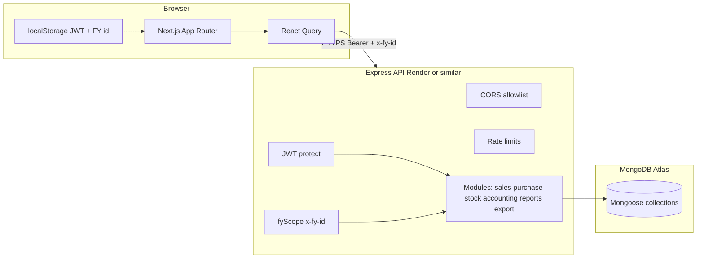

# Production Readiness Report — PKS Billing Application

**Audit date:** 2026-10-26  
**Auditor role:** Architecture / backend / security / financial / QA / DevOps review (code-based)  
**Repositories inspected:**

| Layer | Path |
|--------|------|
| Backend API | `Billing App-B/billing_v1` |
| Frontend | `Billing App-F/billing_v1` (separate folder; not in this git root) |

**Scope:** Static code review, local build/test commands, dependency audit. No production database access, no load tests against live Atlas, no secret values recorded.

---

## 1. Executive summary

The billing stack is a **multi-company, multi-branch, financial-year–scoped** ERP-style app (sales/purchase, GST, stock, receipts/payments, expenses, journals, reports, exports). Core **tenant scoping** (`companyId` on reads/writes) and **server-side invoice line/tax recomputation** on sales create are strong foundations.

**Production release is not recommended yet** without addressing:

- **P1:** Server-side **RBAC not enforced** on most API routes (permissions exist in settings UI/constants only).
- **P1:** **Document number allocation** uses read-then-increment (race under concurrent creates).
- **P1:** **`crudFactory` mass assignment** on master-data updates (customer party fixed; other masters still `$set: req.body`).
- **P2:** **No automated test suite** for financial flows, isolation, or concurrency (only new input-sanitizer tests).
- **P2:** **JWT in localStorage** (XSS → session theft risk).
- **Dependencies:** `npm audit` reports **high** issues in transitive `body-parser` / `brace-expansion` and **moderate** Mongoose prototype-pollution advisory.

Recent hardening (verified in tree): inactive-user JWT rejection, export query sanitization, customer write allowlist, upload magic-byte check, export row limits, history report `branchId` scoping, regex-safe search on several endpoints.

**Release gates:** **GATE 1 (Security)** — **BLOCKED**. **GATE 2 (Financial integrity)** — **BLOCKED** (numbering concurrency not tested). **GATE 6 (Deployment)** — **PARTIAL** (build passes; monitoring/CI not verified).

---

## 2. Architecture (as implemented)

- **Tenant context:** `req.companyId` / `req.branchId` from JWT (user revalidated for `isActive` in `authHandler.js`). **FY:** `x-fy-id` header or active FY for company (`fyScope.js`).
- **Frontend API:** `NEXT_PUBLIC_API_URL` (default production host in `axios.ts`); no DB credentials in client bundle (PASS for secret leakage via env).

---

## 3. Checklist summary

| Area | Items reviewed | PASS | FAIL | BLOCKED | N/A | NOT TESTED |
|------|----------------|------|------|---------|-----|------------|
| Authentication | 11 | 6 | 1 | 0 | 2 | 2 |
| Authorization | 10 | 2 | 4 | 0 | 0 | 4 |
| API security | 22 | 12 | 3 | 0 | 1 | 6 |
| Multi-company isolation | 14 | 8 | 1 | 0 | 0 | 5 |
| Financial accuracy | 18 | 10 | 2 | 0 | 0 | 6 |
| MongoDB / Mongoose | 20 | 7 | 2 | 4 | 0 | 7 |
| Inventory | 10 | 4 | 1 | 0 | 0 | 5 |
| API performance | 12 | 4 | 2 | 0 | 0 | 6 |
| Frontend | 16 | 6 | 2 | 0 | 0 | 8 |
| Testing / QA | 14 | 0 | 2 | 0 | 0 | 12 |
| Deployment / DR | 16 | 3 | 2 | 8 | 0 | 3 |
| **Approx. total** | **~163** | **~62** | **~20** | **~12** | **~3** | **~66** |

Statuses are **evidence-based** from repository inspection and commands below—not production runtime verification.

---

## 4. Findings by severity

### P0 — Critical

| ID | Status | Finding | Evidence |
|----|--------|---------|----------|
| — | **None confirmed open** | Cross-company **IDOR on primary invoice GET** mitigated by `companyId` in services (e.g. `getOneSalesInvoice`). Export/history gaps were partially fixed (`branchId`, `optionalObjectId`). | Code review; no live penetration test. |

### P1 — High

| ID | Finding | Location | Recommendation |
|----|---------|----------|----------------|
| P1-1 | **RBAC not enforced on API** — `permissions.constants.js` + settings UI exist; **no** `requirePermission` middleware on sales/purchase/report/export routes. Any authenticated company user can call APIs. | Most `*.routes.js` only `protect` + `fyScope` | Add server middleware checking effective permissions per route; deny by default. |
| P1-2 | **Invoice / voucher numbering race** — `getNextSalesInvoiceNo` etc. read last doc then increment (`documentNumber.service.js`). Unique index helps **detect** collision but does not prevent duplicate attempts / UX failures under concurrency. | `documentNumber.service.js` | Atomic counter collection per `(companyId, fyId, docType, salesType)` with `findOneAndUpdate` `$inc`, or create inside transaction with retry on 11000. |
| P1-3 | **Mass assignment on CRUD masters** — `crudFactory` `update` uses `{ $set: req.body }` after only stripping `companyId`. | `utils/crudFactory.js` | Per-model allowlists (pattern: `customer.routes.js` `pickCustomerWritePayload`). |
| P1-4 | **Export authorization** — `/api/export` authenticated but not permission-scoped. | `export/export.routes.js` | Map `reportType` → `reports.*.view` permission. |
| P1-5 | **Mongoose advisory (moderate→operational)** — prototype pollution in update casting (GHSA); pinned `mongoose@^9.6.0`. | `package.json` | Upgrade to patched Mongoose when available; avoid passing unfiltered client objects to `$set`. |

### P2 — Important

| ID | Finding | Notes |
|----|---------|-------|
| P2-1 | **No financial / isolation / concurrency tests** | Backend `test` script was placeholder; now 3 sanitizer tests only. |
| P2-2 | **JWT in localStorage** | `token.ts` + axios interceptor — standard SPA risk. |
| P2-3 | **Stock decrement not atomic** | `moveStock` read-modify-write; race can oversell under concurrent sales (in-memory check then save). | Use `findOneAndUpdate` with `$gte` qty condition or transaction. |
| P2-4 | **Pagination unbounded on many custom list services** | `crudFactory` now capped at 100; sales/purchase services still use raw `Number(limit) \|\| 20`. |
| P2-5 | **npm audit high** | `body-parser`, `brace-expansion` transitive — run `npm audit fix` in staging and regression-test. |
| P2-6 | **No CI pipeline in repo** | No GitHub Actions / Render health check config found in tree. |
| P2-7 | **CORS allows missing Origin** | `app.js` — intentional for non-browser clients; review threat model. |
| P2-8 | **7-day JWT default** | `JWT_EXPIRES_IN \|\| "7d"` — long-lived stolen token window. |

### P3 — Improvements

- Structured logging / correlation IDs (morgan only today).
- Cursor pagination for very large invoice lists.
- Background jobs for heavy exports (exports capped at 10k rows but synchronous).
- httpOnly cookie auth (large change).
- Remove debug `console.log` in `warehouse.service.js`.

---

## 5. Security & authorization (detail)

| Check | Status | Evidence |
|-------|--------|----------|
| bcrypt passwords | **PASS** | `user.model.js` / `bcryptjs` |
| JWT alg HS256 | **PASS** | `auth.service.js`, `authHandler.js` |
| Inactive user blocked at login | **PASS** | `auth.service.js` |
| Inactive user blocked on API | **PASS** | `authHandler.js` reloads user |
| Rate limit auth + API | **PASS** | `rateLimiter.js`, `app.js` |
| Helmet | **PASS** | `app.js` |
| JSON body limit 1mb | **PASS** | `app.js` |
| Production stack traces hidden | **PASS** | `errorHandler.js` |
| `.env` gitignored | **PASS** | `.gitignore` |
| Server RBAC | **FAIL** | No permission middleware |
| Branch enforced on every query | **PARTIAL** | JWT `branchId`; not all reports historically scoped — history/export updated |
| Client FY header validated | **PASS** | `fyScope.js` checks `companyId` |
| Refresh tokens | **N/A** | Not implemented |
| CSRF | **N/A** | Bearer token API, not cookie session |

---

## 6. Financial & GST (detail)

| Check | Status | Evidence |
|-------|--------|----------|
| Server recalculates sales invoice lines/tax/totals | **PASS** | `createSalesInvoice` uses DB items, `calculateLineGst`, `computeInvoiceTotals` |
| Branch/customer state for GST supply type | **PASS** | `resolveGstSupplyType`, branch GSTIN/address |
| Snapshots on invoice | **PASS** | customer/price level snapshots in service |
| Trust client grand total on create | **FAIL** (mitigated) | Service recomputes; client totals ignored for persistence |
| Floating-point strategy | **PARTIAL** | `round2` / `toFixed(2)` — not integer paise; documented risk for edge cases |
| Unique invoice number index | **PASS** | `{ companyId, invoiceNo, financialYearId }` unique |
| Atomic sequence | **FAIL** | Read-then-increment numbering |
| Statutory GST compliance claim | **NOT TESTED** | Requires CA/legal review of fields & rules |

---

## 7. Database & indexes

**Observed patterns:** Compound indexes on `(companyId, branchId, financialYearId)`, list sorts on dates, unique business keys (e.g. sales invoice number).

| Item | Status |
|------|--------|
| Index definitions in models | **PASS** (representative: `salesInvoice.model.js`) |
| Explain plans / Atlas performance | **BLOCKED** (no staging Atlas access in audit) |
| Backup / PITR | **BLOCKED** (Atlas plan not visible) |
| Connection pooling | **PASS** (single `mongoose.connect` in `server.js`) |
| Transactions for multi-doc writes | **PARTIAL** | `withTransaction.js` used in some flows; not universal |

**Recommended (review on staging with explain):**

- Confirm prefix queries on `invoiceNo` regex for numbering use index or accept COLLSCAN cost at scale.
- Audit report aggregations under realistic row counts.

---

## 8. Tests executed (this audit)

| Command | Result |
|---------|--------|
| `cd Billing App-B/billing_v1 && npm test` | **PASS** — 3 tests, 0 fail (`tests/sanitizeInput.test.js`) |
| `cd Billing App-F/billing_v1 && npx tsc --noEmit --incremental false` | **PASS** |
| `cd Billing App-F/billing_v1 && npm run build` | **PASS** (local, full permissions) |
| `cd Billing App-B/billing_v1 && npm audit --omit=dev` | **FAIL** — high/moderate advisories (see §4 P2-5) |
| Load / integration / E2E | **NOT TESTED** |
| Atlas restore drill | **BLOCKED** |

---

## 9. Files changed during audit (safe fixes)

| File | Change |
|------|--------|
| `utils/paginationLimits.js` | **Added** — max page size 100 |
| `utils/crudFactory.js` | Clamp pagination |
| `app.js` | `GET /api/health` (no secrets) |
| `tests/sanitizeInput.test.js` | **Added** — input validation tests |
| `package.json` | `test` script → `node --test` |

**Previously hardened (same codebase, pre-audit session):**  
`authHandler.js`, `sanitizeInput.js`, `validateEnv.js`, `customer.routes.js`, `exportReportData.js`, `export.service.js`, upload utils/controller, report history controllers, item/customer search regex, warehouse search.

---

## 10. Deployment & infrastructure risks

| Item | Status |
|------|--------|
| Separate dev/staging/prod | **NOT VERIFIED** |
| Render / Vercel config in repo | **NOT FOUND** (deploy likely manual) |
| HTTPS | **ASSUMED** on production hosts (`api.pksbrozco.com`, Vercel) — **NOT TESTED** |
| Health check for orchestrator | **PASS** (endpoint added; configure Render to use `/api/health`) |
| Stateless API | **PASS** (JWT; uploads on local disk — **FAIL** for multi-instance unless shared storage) |
| Uploads in `uploads/` on disk | **FAIL** for horizontal scale / DR — use object storage or single instance |
| `JWT_SECRET` length in production | **PASS** if env enforces (`validateEnv.js` throws when `NODE_ENV=production` and secret &lt; 32) |

---

## 11. Manual steps requiring your approval

1. **Upgrade dependencies** — `npm audit fix` + Mongoose patch version; full regression in staging.
2. **Enable unique index** on production only after duplicate check (invoice numbers).
3. **Implement RBAC middleware** — product decision on default-deny matrix.
4. **Atomic document sequences** — may require one-time migration / counter collection.
5. **Atlas backup restore test** — run in isolated cluster; document RPO/RTO.
6. **Move uploads to R2/S3** if running &gt;1 API instance.
7. **Penetration test** — cross-company IDOR on all modules (automated integration tests minimum).

---

## 12. Remaining blockers before production

1. Server-side permission enforcement (P1-1).  
2. Concurrency-safe numbering + tests (P1-2).  
3. CRUD allowlists for remaining masters (P1-3).  
4. Test coverage for GST totals, payments, stock, isolation (P2-1).  
5. Dependency audit remediation (P2-5).  
6. Upload storage strategy for production topology (deployment).  
7. Business sign-off on GST/invoice format (Gate 7).

---

## 13. Staged deployment plan (recommended)

| Stage | Actions |
|-------|---------|
| **0 — Staging** | Clone Atlas → staging; apply index changes; run manual + new automated tests. |
| **1 — Security** | RBAC middleware, export permissions, crudFactory allowlists, Mongoose upgrade. |
| **2 — Financial** | Atomic sequences; duplicate-submit/idempotency on invoice create; reconciliation scripts. |
| **3 — Observability** | Wire `/api/health`, error tracking, log redaction, alerts on 5xx rate. |
| **4 — Performance** | Explain slow reports; cap limits on all list endpoints; optional read replicas later. |
| **5 — Production** | Rotate secrets; restrict Atlas IP; CORS to production frontend only; enable backups + tested restore. |

---

## 14. Paid infrastructure (only if justified)

| Service | When |
|---------|------|
| MongoDB Atlas paid tier | Production SLA, backups, PITR, higher connections |
| Object storage (R2/S3) | Multiple API instances or durable attachments |
| Error monitoring (Sentry etc.) | Production incident response |
| Redis | **Not required now** — no evidence of cache layer need until measured |

---

*This report does not certify statutory GST compliance or financial audit correctness. It reflects repository state and local commands run on 2026-10-26.*
